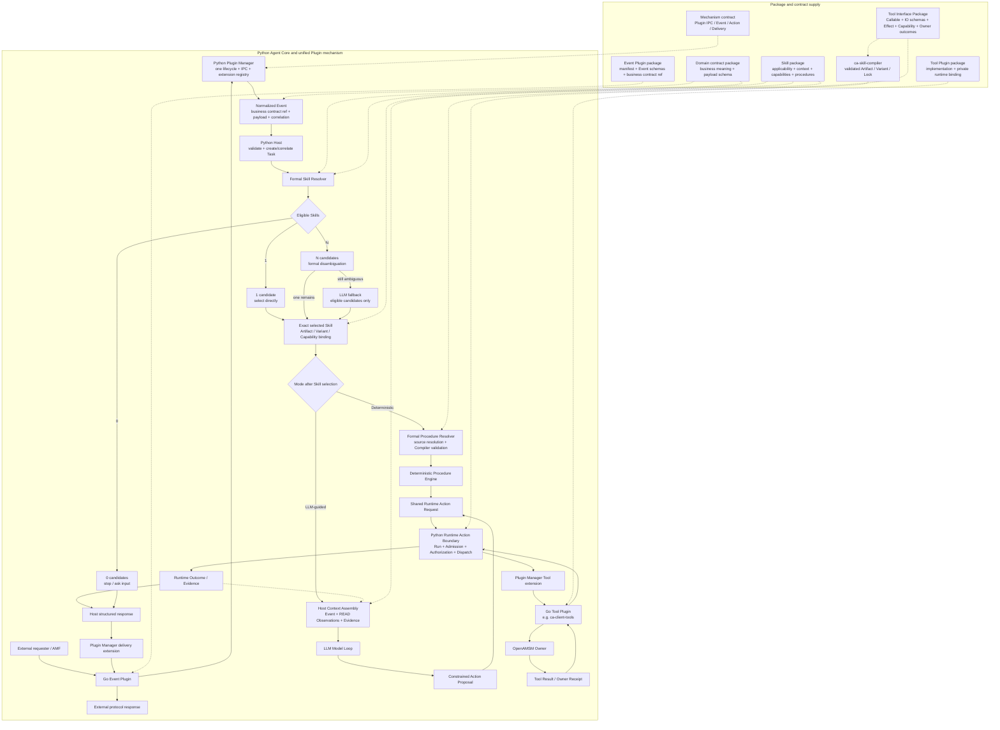

# Architecture baseline — Python Core, unified Plugin extensions

**Status:** target architecture for `ca-agent-next`; implementation **NOT_STARTED**.  
**Audit source:** `ca-agent-demo` main `57e277ff9094dad93543df46910a12a1dbbaf560` plus open PR #246 / #249 reviewed on 2026-11-25.  
**Scope:** Demo-level mechanism implementation, not Production Qualification.

## 1. Repository evolution and language

```text
ca-agent-demo (primary source: existing Python mechanisms + tests)
       |
       | selective reuse, simplification and redesign
       v
ca-agent-next (new Python Agent Core / Host / Runtime)
       |
       | acceptance complete, promotion review
       v
ca-agent (stable implementation target; not source for this redesign)
```

- Agent Core, Host, Agent Model Loop, Skill Resolver and Runtime in next are **Python**.
- Plugins are independent processes. Go is appropriate for OpenAMSM/Tool Plugin implementations; it is not the Agent Core language.
- `ca-skill-compiler`, `ca-client-tools`, `ca-skills` and Plugin repositories remain independent package owners. Do not copy their implementation into next.

## 2. One extension mechanism: Plugin

A Plugin is the generic extension unit: one package/process, one lifecycle and one Host-managed IPC connection. It may expose one or more extension kinds.

| Plugin extension | Direction | Purpose |
|---|---|---|
| `event.ingress` | Plugin → Host | Publish normalized external Event/Task input |
| `event.delivery` | Host → Plugin | Deliver a validated response to the originating protocol |
| `tools` | Host → Plugin | Export callable Tool operations invoked through Runtime |
| optional combined | both | One process may expose Event and Tool extensions together |

**Tool is not another process/runtime abstraction.** A Tool is a callable operation exported by a Plugin. A Tool Plugin is a Plugin that exports Tools. One Plugin can export many Tools; one process per Tool is not required.

### 2.1 Unified manager and protocol

- One Python Plugin Manager loads declared Plugin packages/processes, owns lifecycle, handshake, message correlation, shutdown and extension discovery.
- One generic Plugin IPC envelope carries lifecycle and extension messages. The common mechanism defines only generic frame identity/correlation and extension operations.
- Tool invocation is a Plugin extension method. Event ingress/delivery are different extension methods on the same mechanism.
- The existing `ca-client-tools.provider/v2` is an already released Tool process protocol. It may initially be consumed by a small Tool-Plugin driver inside the unified Plugin Manager. This is a migration adapter, **not** a second Provider Manager or a second Runtime. Do not rewrite or copy the Go implementation just to rename the protocol.
- Converge new Plugin implementations on the shared Plugin mechanism after the Echo Example proves the boundary. Do not maintain two permanent process managers, registries, catalogs or authorization paths.

### 2.2 Tool contract is still package-owned

The Plugin mechanism does not become a global ToolCatalog.

- The Tool-owning Interface Package defines public Callable ID, input/output Schema, Effect, Capability membership and Owner outcome/receipt/reconcile contract.
- The Tool Plugin package carries or references that exact Interface Package and its digest, plus private implementation/runtime binding.
- The Plugin manifest references the Interface Package; it must not duplicate its Tool definitions.
- The Runtime builds its available Tool registry from imported Interface Packages and loaded Tool Plugin bindings. The selected Skill's Capability requirements determine the invocation-scoped allowlist.
- Registration/availability is not authorization. Only the selected Skill + Host/Runtime admission grants the action.

This preserves the Compiler-compatible Interface Package already published by `ca-client-tools` and prevents a second Tool contract authority.

### 2.3 Existing repositories as Plugin types

| Repository | Plugin role | Boundary |
|---|---|---|
| `ca-openamsm-plugin` | Event Plugin | SBI listener, protocol decoding/normalization, Event publication and SBI response delivery. No Skill selection, RunStore, Runtime or Owner Tool implementation. |
| `ca-client-tools` | Tool Plugin | OpenAMSM Tool operations, Provider process, private backend binding and Owner calls. No Agent Model Loop, Skill selection or Runtime authorization. |
| Echo Example | Combined Plugin | Minimal Event ingress/delivery plus one or more Tools to prove the common extension mechanism. |

The two OpenAMSM projects remain independent because they own different work. They share one Plugin mechanism, not one business implementation. Do not move MAS Owner calls from `ca-client-tools` into `ca-openamsm-plugin`.

## 3. Contract ownership: mechanism public, business package-owned

| Contract/data | Owner | Imported/consumed by |
|---|---|---|
| Plugin lifecycle, IPC, extension method envelopes | Shared mechanism contract (initially documented/versioned in next) | Host and all Plugins |
| Event type, event meaning, request payload Schema, response Schema, protocol artifact declarations | Event Plugin/domain package | Host Event intake and Skill Resolver |
| Business Goal/intent meaning shared across packages | Owning domain contract package | Plugin and applicable Skills |
| Skill applicability, Goal, Context Requirements, Capability declarations, Procedures, Predicates and completion conditions | Skill package | Formal Resolver, Compiler, Runtime |
| Tool Callable ID, input/output Schema, Effect, Capability membership, Owner Receipt/Commit/Reconcile semantics | Owner Interface Package | Compiler and Runtime |
| Tool implementation and private runtime binding | Tool Plugin package/release | Plugin Manager and Runtime |
| CA-SL syntax and compiler artifact format | `ca-skills` / `ca-skill-compiler` | Skill authoring/build/admission |

Rules:

- No central business Goal Registry.
- No Event → Skill mapping table.
- No Event → execution-mode mapping.
- Plugin Event Contract carries a business-contract reference and payload, not a Skill ID.
- Skill declares which business-contract references it supports. The Resolver matches imported packages by contract identity and validates schemas/applicability.
- Host configuration may choose package sources, available Plugin processes and a generic default execution mode. It must not encode business-specific routing.

No new `ca-contracts` repository is required for the Demo. Keep the generic Plugin mechanism contract small and versioned; keep business contracts beside their owners.

## 4. Skill-first, Formal-first selection

Every business request—including Plugin-originated Events—must pass through Skill selection. There is no direct generic Agent-to-Tool path.

1. Plugin receives/decodes an external request.
2. Plugin publishes a normalized Event containing the Event type, business-contract package reference, payload and correlation metadata.
3. Host validates the generic envelope and the Plugin-owned Event Schema; creates/correlates a Task.
4. Formal Skill Resolver examines imported Skill packages using:
   - exact business-contract reference and input Schema;
   - Skill-declared applicability/Goal;
   - Host Base Capability Envelope;
   - required Context availability;
   - available exact Skill Artifact/Variant and declared Capability closure.
5. Candidate result:
   - **0:** stop or ask for missing input; never ask LLM to invent a Skill.
   - **1:** select directly; no LLM call.
   - **N:** apply formal rules first; if ambiguity remains, LLM may choose only within the eligible set; Host validates the exact Skill identity.
6. Bind exact Skill package, Artifact/Variant and Capability requirements.
7. Only now choose Deterministic or LLM-guided execution, constrained by Skill-supported modes and generic request/deployment policy.
8. Execute through the same Runtime Action Boundary.
9. Host assembles a structured response; originating Plugin performs protocol-specific delivery.

LLM participation in Skill selection does not mean the Run uses LLM-guided execution.

## 5. Procedure and execution-mode selection

### 5.1 Procedure selection/source resolution

Within the selected Skill, use Formal-first Procedure selection. LLM may help only when more than one formally eligible candidate remains ambiguous; it cannot create a new candidate outside the selected Skill's declared Procedure surface.

Procedure sources may include `STATIC`, `LLM_PROPOSAL`, `FALLBACK` and `PATCH-DERIVED`. Every source must converge through deterministic schema/semantic validation, Compiler build/verify and exact Artifact/Variant binding before execution.

Fallback may select only a published deterministic Procedure explicitly marked fallback-eligible. UNKNOWN facts, unresolved predicates or missing required Context remain unresolved; do not silently convert them to PASS.

### 5.2 Two execution modes

- **Deterministic:** the Runtime Procedure Engine advances the selected, validated Procedure.
- **LLM-guided:** Host/Agent runs the model loop and proposes the next Action inside the selected Skill's declared constraints.

Both modes submit the same conceptual `RuntimeActionRequest` to the same Runtime Action Boundary. No direct Plugin call from the LLM and no second Tool dispatcher.

## 6. Runtime boundary

| Component | Owns | Does not own |
|---|---|---|
| Python Host | Plugin Manager, package loading, Task/Run orchestration, Formal Resolver, model loop orchestration, Context assembly, response coordination | business truth or a second authorization mechanism |
| Python Agent | Intent understanding, constrained ambiguity resolution, LLM-guided next-action proposal | direct Plugin invocation, Capability grants, authoritative commit status |
| Skill | Business Goal, applicability, required Context, Capabilities, Procedures, Predicates and completion conditions | Plugin lifecycle or Tool implementation |
| Python Runtime | Skill Run state, exact Artifact/Capability binding, common Action Request, admission/authorization, Tool dispatch through Plugin Manager, Effect/Outcome/Evidence, Wait/Resume/Reconcile | LLM Model Loop or Plugin protocol parsing |
| Deterministic Procedure Engine | Validated Procedure progression and Action derivation | independent Tool dispatch/authorization |
| Plugin Manager | Plugin process lifecycle, IPC, extension discovery, Event ingress/delivery, Tool invocation transport | Skill selection, business authorization, business outcome |
| Tool Plugin | Tool implementation and Owner-facing calls; return Tool result/receipt | Skill selection, Runtime authorization, Owner truth beyond its actual receipt |
| Event Plugin | Protocol decoding/normalization and protocol response encoding | Skill selection, Run lifecycle, business Tool calls |
| Owner | Authoritative business state and commit result | Agent reasoning |

The Runtime may contain the deterministic Procedure Engine. It does not contain the LLM Model Loop.

## 7. Context and Observation provenance

Context is a Host-assembled view of facts, not a new authority.

| Context item | Origin | Semantics |
|---|---|---|
| External request/Event | Event Plugin | Push input; retain event/package/schema/correlation reference |
| Current business state | Tool Plugin READ operation | Pull Observation; retain Tool ID, Interface Package digest, invocation/result reference and freshness when supplied |
| Execution result / Owner Receipt / Commit Proof | Runtime + Tool Plugin/Owner | authoritative execution Evidence; validate exact scope and identity |
| Context requirements and business constraints | Selected Skill package | tells Host what facts are required |
| Available actions | Selected Skill + admitted Interface Package/Plugin binding | declared Capability surface, not a model grant |

A model-generated sentence is not an Observation. A successful transport response is not automatically COMMITTED. READ and MUTATION both use the same Tool Plugin dispatch boundary, but their Effects and outcome semantics differ.

## 8. End-to-end flow

Solid arrows are runtime data flow. Dashed arrows are package/contract imports.



The Plugin does not name the Skill. The Skill declares supported business contracts and required Capabilities. The Host resolves the Skill formally, then selects the execution mode. Both execution modes enter the same Runtime Action Boundary.

## 9. What is reused from ca-agent-demo

The source audit is in [ca-agent-demo audit](audit/ca-agent-demo.md). The short version:

- Reuse selected Python Agent, Formal Resolver, Context, Runtime Tool boundary, Outcome/Evidence and Run mechanisms where dependency/tests prove they are generic.
- Replace current structured Event → Root routing configuration with package-owned Skill applicability and Formal-first resolution; do not copy the mapping table.
- Do not reuse `MockCompiler` as the compiler or `MockRuntime` as a production engine. Integrate the real Go Compiler and build the new shared Runtime boundary.
- Use the generic Provider loader from PR #246 as implementation evidence/input, but absorb Tool process management into the unified Plugin Manager.
- Do not move the entire `integrations/fivegc/` directory or any Nsmf Run executor into the Plugin.

## 10. External reusable projects

- `ca-skill-compiler v2.1.0`: independent Go compiler; invoke its CLI from Python and consume immutable Artifacts. Host admission remains separate.
- `ca-client-tools v1.2.0`: independent Go Tool Plugin; use its Interface Package and runtime bindings. The existing `ca-client-tools.provider/v2` can be bridged by a Tool-Plugin driver in the common Plugin Manager.
- `ca-skills`: consume CA-SL v1alpha5 Skill packages, including the existing Create/Modify/Release examples.
- `ca-openamsm-plugin`: Go Event Plugin, currently design-only; align its Agent-first/optional-Skill wording with Skill-first before implementation.
- No external Go source tree is copied into Python next.

## 11. Demo-level non-goals

Defer production HA/distributed failover, complex multi-tenant security governance, Marketplace, central business registry, distributed Event Bus, cross-Plugin delivery, separate event database, complex compensation orchestration, broad legacy compatibility and elaborate DFX.

Keep only the minimum for a credible Demo: package/Schema validation, clear errors, exact Skill/Artifact/Capability identity, basic correlation, one Plugin Manager, one Runtime Action Boundary and runnable acceptance Examples.
