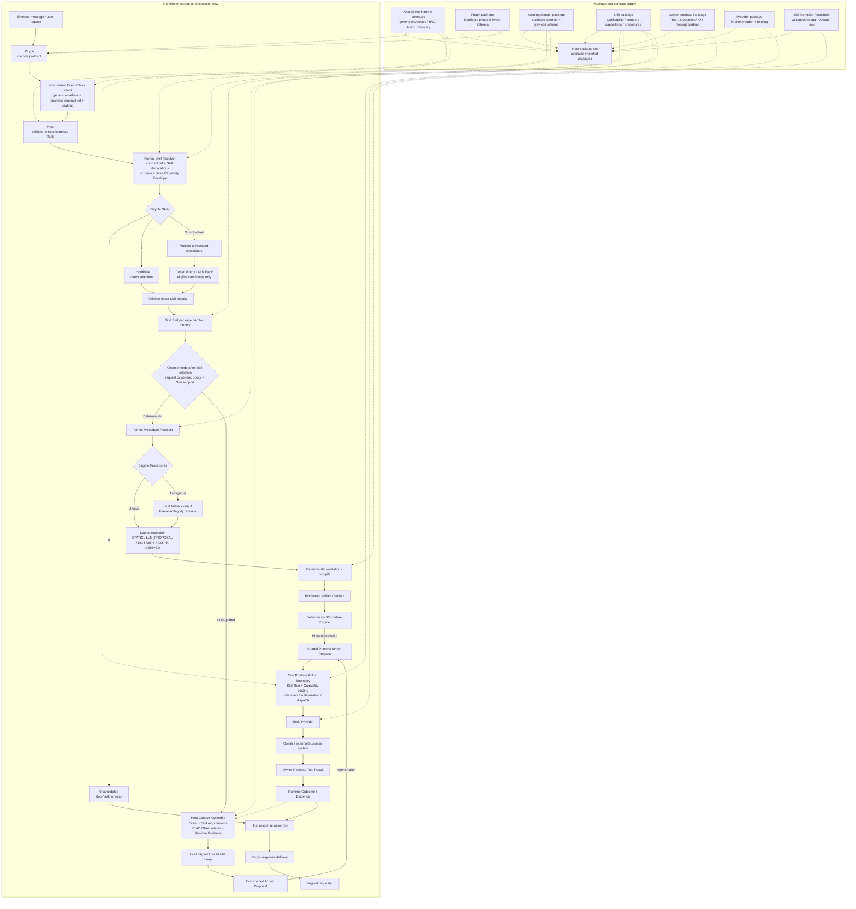

# Architecture baseline

**Status:** accepted design direction; implementation not started in this repository.  
**Scope:** Demo-level Agent mechanism, not a production platform.

This document is the canonical architecture baseline for `ca-agent-next`. It intentionally describes the smallest coherent system needed to prove the extension and execution model.

## 1. Core model

A business request always executes through a selected Skill.

The order is:

1. Receive an external event or user request.
2. Create a generic Task carrying a reference to the business contract and its input.
3. Resolve a Skill using **Formal-first selection**.
4. Bind the exact Skill package/artifact identity.
5. Select an execution mode supported by that Skill.
6. Execute inside the Skill boundary. Deterministic Procedure execution and LLM-guided execution share one Runtime Action Boundary.
7. Return the result through the originating ingress/delivery path.

There is no generic Agent path that receives an event and directly calls business Tools without a Skill.

## 2. Contract ownership and extension

### 2.1 Public contracts contain mechanisms only

The shared/public contract source (currently represented by the `connectionagent` mechanism-contract baseline) defines reusable interaction mechanisms, for example:

- generic Plugin IPC and lifecycle;
- generic Event/Task/Run envelopes and correlation references;
- package import/discovery interfaces;
- Skill/Procedure selection request and result shapes;
- generic Runtime Action Request/Result;
- generic Observation, Evidence, and Response Delivery mechanics.

It must not define business Goal enumerations, OpenAMSM concepts, Create/Modify/Release, SUPI/QFI, or a central business registry. `ca-agent-next` consumes shared mechanism contracts; it does not copy them into a second authority.

### 2.2 Business contracts travel with their owning package

| Package owner | What it publishes |
|---|---|
| Plugin package | Protocol Manifest, protocol Event schemas, protocol-specific decoding and delivery metadata |
| Domain/contract package (when a business meaning is shared) | Domain Goal/intent semantics and business input/output schemas |
| Skill package | Supported business-contract references, Goal applicability, Context Requirements, Capability declarations, Procedure, Predicates, business constraints, and completion conditions |
| Owner Interface Package | Callable/Tool/Operation contracts, input/output schemas, and Owner Receipt/Commit semantics |
| Provider package | Provider implementation and its binding to the Owner Interface Package |
| Skill Compiler/toolchain | Validated Skill Artifact, Variant, dependency/lock material |

A business contract is published by the package that owns that meaning. If a Plugin and a Skill both need it, one owning domain package publishes it and the other imports it by a versioned package reference. It does not move into the public mechanism contract merely because multiple packages consume it.

### 2.3 No business mapping table

Do not add:

- Event → Skill mappings;
- Event → execution-mode mappings;
- a central business Goal enum or Goal Registry;
- Plugin configuration containing a Skill ID;
- Host code that knows OpenAMSM business names.

A Plugin translates its external protocol into a generic Event/Task envelope and references the relevant business contract package. A Skill declares which business contract references it supports. The generic Resolver compares those package references and validates the corresponding schemas; it does not need to understand the business vocabulary.

The Host may configure which package sources/packages are available and a generic default execution policy. That is package availability/configuration, not a per-event business routing table.

### 2.4 Extension expectations

- Add a Skill supporting an existing business contract: publish/import the Skill package; do not change Agent Core or public mechanism contracts.
- Add a Plugin producing an existing business contract: publish/import the Plugin package; do not change Agent Core or the Skill.
- Add a Provider/Tool: publish the Owner Interface contract and Provider binding/implementation; do not add business-specific dispatch code to Agent Core.
- Add a new business meaning: publish it with its owning domain package and have the relevant Plugin/Skill packages import it. Do not add it to a central public business enum.

## 3. Plugin, Host, Agent, Skill, Runtime, and Provider

| Component | Owns | Does not own |
|---|---|---|
| Plugin | External protocol ingress, protocol decoding, normalized Event production, response encoding/delivery | Skill ID selection, execution-mode selection, Skill Run, Runtime, business Tool execution |
| Host | Package loading, Task creation/correlation, Formal Resolver orchestration, model loop orchestration, Context assembly, response coordination | Owner business truth or a second Tool execution authority |
| Agent / LLM | Intent understanding when needed, constrained Skill/Procedure fallback selection, LLM-guided decisions, Action proposals | Candidate expansion, Capability grants, direct Provider calls, authoritative outcomes |
| Skill | Business intent applicability, required context, declared capabilities, business constraints, Procedures, completion criteria | Plugin implementation details or Provider internals |
| Runtime | Skill Run state, exact Skill/Capability binding, common Action Request boundary, Admission/Authorization, Tool dispatch, effect/outcome/evidence, Wait/Resume/Reconcile | LLM Model Loop or business Skill selection |
| Procedure Engine | Deterministic progression through a validated Procedure | Independent Provider/authorization implementation |
| Tool / Provider | Atomic callable capability and its implementation | Skill selection or Agent orchestration |
| Owner | Authoritative business state and commit result | Agent reasoning |

A Plugin is a protocol boundary. A Tool is an atomic capability boundary. Do not create one Plugin per Observation.

## 4. Formal-first, layered selection

Selection is not one unrestricted LLM Router. It is a sequence of independently validated bindings.

### 4.1 Skill Selection

The Host Resolver uses:

- generic Task intent and the referenced business contract package;
- imported Skill declarations and their supported business-contract references;
- input schema validity;
- Host Base Capability Envelope;
- required context availability;
- available, valid Skill Artifact/Variant identities.

The Resolver first filters and resolves candidates formally:

| Eligible candidates after formal filtering | Behavior |
|---|---|
| 0 | Stop / request missing input. LLM must not invent a Skill. |
| 1 | Select it directly; no LLM call. |
| More than 1, and deterministic rules resolve one | Select the formal result; no LLM call. |
| More than 1, and ambiguity remains | LLM may choose only from the eligible candidates. Host validates the exact returned Skill identity. |

LLM fallback cannot add candidates, bypass eligibility, or return an arbitrary Skill ID.

### 4.2 Execution mode is selected only after the Skill

A selected Skill declares supported modes and may express a preference. The Host applies an explicit per-request choice or a generic deployment default/policy, constrained by the Skill's supported modes and task requirements.

The two modes are:

- **Deterministic:** execute a validated CA-SL Procedure using the Runtime's Procedure Engine.
- **LLM-guided:** the Host/Agent runs the model loop and proposes the next Action within the selected Skill's constraints.

Do not map Event types to modes. If the requested/default mode is unsupported or no compatible mode exists, stop clearly.

LLM participation in Skill or Procedure selection does **not** by itself mean the Run uses LLM-guided execution.

### 4.3 Procedure selection and source resolution

For the deterministic mode, select a Procedure within the already selected Skill. Use formal filtering first. If multiple eligible Procedures remain indistinguishable, LLM may make a constrained proposal from that candidate set; the proposal must return through deterministic validation.

Procedure sources may include:

- `STATIC`;
- `LLM_PROPOSAL`;
- `FALLBACK`;
- `PATCH-DERIVED`.

Every source converges through deterministic validation/compilation and exact Artifact/Variant binding before execution. An LLM proposal is not executable merely because the model produced it.

Fallback may select only a published deterministic Procedure explicitly marked as eligible for fallback. If facts are insufficient, an UNKNOWN condition is unresolved, or no eligible fallback exists, stop safely. Fallback is a source/selection path, not a third execution mode.

### 4.4 Resource binding

Before execution, bind exact identities for the selected Skill, Artifact/Variant, declared Capabilities, and the relevant Provider/Tool contracts. The Runtime receives this resolved binding; it must not infer business permissions from model output.

## 5. One Runtime Action Boundary

The Host/Agent owns the model loop. The Runtime owns governed execution.

Both modes submit the same conceptual Action Request:

- Deterministic Procedure Engine: Action derived from the current validated Procedure node.
- LLM-guided Agent: Action proposal derived from the current Model-visible Context and Skill constraints.

Both enter the same Runtime Action Boundary and use the same Skill Run, Capability binding, input validation, Admission/Authorization, Provider dispatch, Effect/Outcome/Evidence, and recovery behavior.

The LLM must not call a Provider directly, widen the selected Skill's Capabilities, or declare an Owner operation committed. Runtime/Owner facts determine the result.

The Runtime may contain a Deterministic Procedure Engine, but it is not the LLM Agent and must not contain the LLM Model Loop.

## 6. Context and Observation provenance

Context is an assembled view of facts, not a new source of truth.

| Context input | Fact source | How it enters |
|---|---|---|
| External request/event | Plugin | Push ingress |
| Current business state | READ Tool / Provider | Pull Observation through Runtime |
| Execution status and proof | Runtime / Owner Receipt | Runtime Evidence |
| Required context and business constraints | Selected Skill package | Declared requirements |
| Available action surface | Selected Skill + resolved Runtime binding | Declared/validated Capabilities |

The Host assembles the Model-visible Context according to the selected Skill's requirements. Keep lightweight provenance references (source/package, schema/version, event or invocation reference, and evidence/result reference) so the Agent can distinguish user input, external facts, and execution facts.

A model-generated statement is not an Observation. A Tool response is not automatically a committed business outcome. Context assembly does not grant capabilities.

## 7. End-to-end flow and contract supply

Solid arrows show runtime data flow. Dashed arrows show package/contract publication and import dependencies.

The package set is an available set of imported packages, not a central business registry or an Event-to-Skill mapping. The Plugin does not name the Skill. The Skill declares applicability to the business contract reference. The Host Resolver performs the match.

## 8. Repository evolution

- `ca-agent` remains the current stable Go Agent baseline while this experiment proceeds.
- `ca-agent-demo` remains a mechanism prototype and cross-component reference.
- `ca-agent-next` is an isolated implementation workspace to avoid mixing old architecture, VibeCoding instructions, issues, and CI context.
- After the new implementation passes its agreed acceptance baseline, it can be promoted to `ca-agent`. A later major redesign starts from a newly created `ca-agent-next`.

The reference `ca-agent` baseline inspected for this document is commit `447d0cce7e42c7c1184b11fb2563792eead68d51` (2026-11-18). This is a comparison baseline, not a claim that the existing implementation already follows this new architecture.

## 9. Demo-level non-goals

Do not design this repository as a production platform. Unless explicitly re-scoped later, defer:

- production high availability and distributed failover;
- complex multi-tenant isolation and enterprise security governance;
- full production DFX, elaborate observability platforms, or SLO systems;
- Marketplace, central business registry, and distributed Event Bus;
- complex compensation/workflow orchestration;
- broad legacy-version compatibility or parallel old/new execution paths.

Keep the minimum needed for a credible Demo: basic schema validation, clear errors, simple package loading, minimal Task/Event correlation, useful logs, and runnable acceptance examples. Demo scope does not permit bypassing Skill selection, Capability boundaries, or the shared Runtime Action Boundary.
